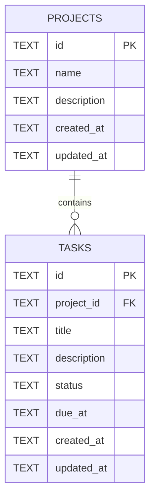

# Projects & Tasks: SQL vs. MongoDB

Minimal Flask application exposing **the same REST API** over two persistence models:
- **SQLite (SQL, normalized 3NF):** `projects` + `tasks` tables, a foreign key, and `ON DELETE CASCADE`.
- **MongoDB (NoSQL):** one `projects` document per project, with an embedded `tasks` array.

This is an original educational demo inspired by a Google Tasks-style interface, not an integration with Google Tasks or Calendar.

## Install and run

Prerequisites: Python 3.10+ and, for real MongoDB testing, Docker Desktop with `docker compose`.

```bash
python -m venv .venv
# Windows PowerShell: .venv\Scripts\Activate.ps1
# macOS/Linux: source .venv/bin/activate
pip install -r requirements.txt

docker compose up -d mongo
python app.py
```

The default SQLite path is `tasks.sqlite3` (created automatically); the default Mongo URI is `mongodb://localhost:27017` and database is `task_polyglot`. Configuration environment variables: `SQLITE_PATH`, `MONGO_URI`, `MONGO_DB`, and `PORT`. If MongoDB is offline, SQL endpoints still work and `/api/mongo/...` returns HTTP 503. `docker compose down` stops Mongo; `docker compose down -v` **deletes its demo data**.

In another terminal:
```bash
python smoke_test.py
pytest -q
```

`smoke_test.py` uses HTTP against **both actual databases**. `pytest` tests SQLite and an in-memory MongoDB-compatible mock (mongomock), and does not replace a real MongoDB integration test.

## REST API (same paths for `sql` and `mongo`)

| Method | URL | Purpose |
| --- | --- | --- |
| POST | `/api/{backend}/projects` | Create project, JSON `{ "name": "Site", "description": "..." }` |
| GET | `/api/{backend}/projects` | List projects (includes tasks) |
| GET | `/api/{backend}/projects/{id}` | Read complete project with tasks |
| PATCH | `/api/{backend}/projects/{id}` | Update `name` or `description` |
| DELETE | `/api/{backend}/projects/{id}` | Delete project and tasks |
| POST | `/api/{backend}/projects/{id}/tasks` | Create task, JSON `{ "title": "Plan", "status": "todo" }` |
| GET | `/api/{backend}/projects/{id}/tasks` | List tasks |
| GET | `/api/{backend}/projects/{id}/tasks/{task_id}` | Read one task |
| PATCH | `/api/{backend}/projects/{id}/tasks/{task_id}` | Update `title`, `description`, `status`, or `due_at` |
| DELETE | `/api/{backend}/projects/{id}/tasks/{task_id}` | Delete task |

Task status is `todo`, `in_progress`, or `done`. `due_at` is nullable and, when set, must be an ISO 8601 timestamp with a timezone. Dates are stored as UTC ISO strings in this demo to keep output identical across backends. MongoDB production systems commonly use BSON Date types instead.

Example (PowerShell-friendly `curl.exe`):
```bash
curl.exe -X POST http://127.0.0.1:5000/api/sql/projects -H "Content-Type: application/json" -d '{"name":"Website"}'
```

Or use Postman to post JSON; copy the returned project ID for subsequent calls.


## Database Schemas

### SQLite — Relational Model

The relational database separates projects and tasks into two normalized tables. Each task belongs to one project, while each project can contain multiple tasks.



The `project_id` foreign key references `projects.id` with `ON DELETE CASCADE`. The schema also includes indexes for task lookups by project and status.

See [schema.sql](schema.sql) for the complete SQL DDL.


### MongoDB — Embedded Document Model

MongoDB stores each project and its tasks in a single document within the `projects` collection.

```json
{
  "_id": "project-uuid",
  "name": "Website Redesign",
  "description": "Update the website",
  "created_at": "2026-11-13T12:00:00Z",
  "updated_at": "2026-11-13T12:00:00Z",
  "tasks": [
    {
      "id": "task-uuid-1",
      "title": "Create Wireframes",
      "description": "",
      "status": "todo",
      "due_at": null,
      "created_at": "2026-11-13T12:00:00Z",
      "updated_at": "2026-11-13T12:00:00Z"
    },
    {
      "id": "task-uuid-2",
      "title": "Review Design",
      "description": "",
      "status": "in_progress",
      "due_at": null,
      "created_at": "2026-11-13T12:00:00Z",
      "updated_at": "2026-11-13T12:00:00Z"
    }
  ]
}
```

Embedding tasks allows the application to retrieve a complete project with one query instead of performing joins between collections.

See [mongo_schema.json](mongo_schema.json) for the original schema example.

## Modeling tradeoffs

**SQL:** `projects` and `tasks` are separate, so each fact is stored once; `tasks.project_id` references `projects.id`; deleting a parent cascades to child rows; fetching a complete project involves two indexed queries in this implementation (or could use a join). The table/index schema is in `schema.sql`.

**MongoDB:** `projects` stores a `tasks` array. `find_one({_id: id})` loads the complete project with its tasks in a single query; `$push`, `$set` with positional `$`, and `$pull` modify the nested array atomically within its parent document. Deleting a project inherently removes its embedded tasks. An example extended-JSON document is in `mongo_schema.json`.

**Constraints:** MongoDB documents have a 16 MiB maximum size, so embedding works best for modest task counts. Consider a separate `tasks` collection with a `project_id` index if task arrays can grow very large or tasks must be queried frequently across projects. The included `tasks.id` multikey index is optional for this demo; `_id` already handles project retrieval, and nested task lookup is scoped to the project. Both backends need application-level authorization in a real multi-user environment.

**Caveats:** For teaching clarity, the demo does not implement authentication, pagination, concurrent write conflict handling, migration tooling, or production deployment configuration. `SQLITE_PATH=:memory:` is not supported here because the repository opens separate SQLite connections.


## AI-Generated Code Audit

The initial implementation was generated with assistance from ChatGPT and reviewed against the assignment's database architecture requirements.

The audit identified three issues:

1. **MongoDB mock compatibility:** Updated the embedded task retrieval method to work with both MongoDB and mongomock.
2. **SQLite foreign key enforcement:** Verified that SQLite requires `PRAGMA foreign_keys = ON` for each connection.
3. **Missing constraint test:** Added an automated test to verify that SQLite rejects orphaned tasks.

See [AI_AUDIT.md](AI_AUDIT.md) for the full findings, corrections, and verification results.

## Quality Assurance Results

| Test | Result |
|---|---|
| SQLite CRUD operations | PASS |
| MongoDB CRUD operations | PASS |
| SQL JOIN retrieval | PASS |
| SQL foreign key rejection | PASS |
| SQL ON DELETE CASCADE | PASS |
| MongoDB embedded document retrieval | PASS |
| MongoDB atomic embedded task update | PASS |
| MongoDB document deletion | PASS |
| Automated pytest suite (5 tests) | PASS |
| HTTP smoke tests (both databases) | PASS |


### HTTP Status & Terminal Verification

The Flask API was tested against both SQLite and MongoDB.

| HTTP Status | Verification | Result |
|---|---|---|
| 200 OK | Successful GET and PATCH requests | PASS |
| 201 Created | Successful project and task creation | PASS |
| 204 No Content | Successful deletion | PASS |
| 400 Bad Request | Empty project name rejected | PASS |
| 404 Not Found | Deleted records no longer accessible | PASS |

**Terminal Health:** Flask request logs were reviewed after running the CRUD smoke tests and invalid-input tests. No unexpected exceptions or database driver warnings were observed.

**Note:** Browser requests for `/favicon.ico` returned 404 because no favicon is configured. These are unrelated to API functionality.

### Testing Commands

Run automated unit and integration-style tests:

```bash
python -m pytest -v
```

Run HTTP smoke tests against the running Flask API and actual databases:

```bash
python smoke_test.py
```

**Testing environments:**
- SQLite: Actual local SQLite database
- MongoDB: Actual MongoDB instance through Docker
- Automated pytest tests: SQLite and mongomock
- API: Flask development server

All listed tests passed after the identified corrections.


## AI Disclosure & Prompt Appendix

**AI Tool Used:** ChatGPT

ChatGPT was used to generate the initial SQL and NoSQL schemas, Python CRUD implementation, and supporting application files. The generated code was then reviewed, corrected, and tested manually.

### Initial AI Prompt

> Act as a senior database architect. I am designing a backend feature for a Task Management System with Projects and Tasks: https://calendar.google.com/calendar/u/0/r/tasks
>
> I need to implement polyglot persistence to compare relational (SQL) and non-relational (NoSQL) modeling:
>
> **1. Relational Schema (PostgreSQL/MySQL/SQLite):**
>
> - Create normalized (3NF) tables with primary keys, foreign keys, timestamps, and indexes.
> - Ensure proper referential integrity (e.g., ON DELETE CASCADE).
>
> **2. NoSQL Schema (MongoDB/Document Store):**
>
> - Design an idiomatic document model for the exact same domain.
> - Optimize for reading a complete project with its associated tasks in a single query (denormalized or embedded array).
>
> **3. Working Application / CRUD Service (Node.js or Python):**
>
> - Implement basic CRUD endpoints/methods for both databases:
>   - Create a record/document
>   - Read by ID and list all records
>   - Update an attribute
>   - Delete a record
>
> **4. A minimal frontend or test script** to execute and verify these operations against both databases.
>
> Provide the SQL DDL statements, NoSQL schema/JSON structure, database connection logic, and CRUD controller code.

### AI Output Review

**What the AI generated correctly:**

- Normalized SQL tables with primary and foreign keys.
- SQL indexes, parameterized queries, and cascading deletion.
- UUID-based identifiers.
- MongoDB documents with embedded tasks.
- Unified Flask CRUD endpoints for both databases.
- Automated CRUD and validation tests.

**Corrections and additional verification:**

- Updated MongoDB task retrieval for compatibility with `mongomock`.
- Verified SQLite foreign key enforcement for database connections.
- Added an explicit foreign key constraint test.
- Verified SQL JOINs and cascade deletion directly in SQLite.
- Verified MongoDB document retrieval, atomic updates, and deletion using `mongosh`.

See [AI_AUDIT.md](AI_AUDIT.md) for the detailed audit.
